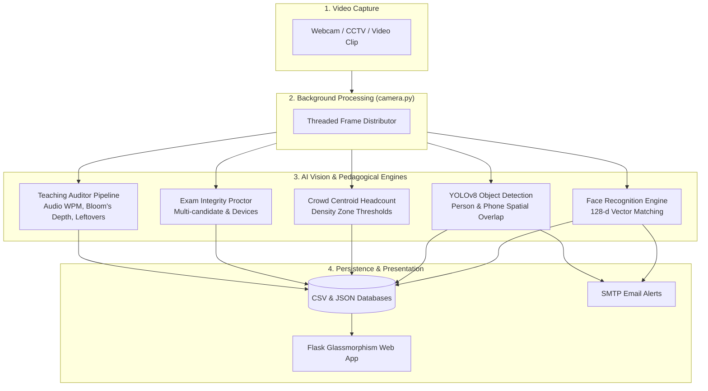

# 📘 VidNetra: Workflows, Architecture & Requirements Guide

> **AI & Computer Vision Classroom Intelligence and Campus Safety Platform**  
> *Faculty of Engineering & Technology, Parul University*  
> **Mentor:** Md Mehedi Hasan | **Lead:** Kuchipudi Lakshmi Venkatesh & Team

---

## 📋 Table of Contents
1. [Project Overview & Mission](#1-project-overview--mission)
2. [Hardware & Software Requirements](#2-hardware--software-requirements)
3. [Environment Setup & Installation](#3-environment-setup--installation)
4. [Configuration & Security Architecture](#4-configuration--security-architecture)
5. [End-to-End System Pipelines](#5-end-to-end-system-pipelines)
   - [Facial Attendance Workflow](#facial-attendance-workflow)
   - [Classroom Distraction & Phone Detection](#classroom-distraction--phone-detection)
   - [Crowd Density & Stampede Prevention](#crowd-density--stampede-prevention)
   - [AI Exam Proctoring Pipeline](#ai-exam-proctoring-pipeline)
   - [5-Stage AI Teaching Auditor Pipeline](#5-stage-ai-teaching-auditor-pipeline)
6. [GitHub Workflow & Contribution Guide](#6-github-workflow--contribution-guide)
7. [API & REST Endpoints Specification](#7-api--rest-endpoints-specification)
8. [Troubleshooting & FAQ](#8-troubleshooting--faq)

---

## 1. Project Overview & Mission

**VidNetra** ("Visual Third Eye") is an AI and Computer Vision blended solution engineered to safeguard classroom environments, automate institutional governance, and deliver pedagogical insights.

### Core Objectives:
- **Zero-Friction Attendance**: Automated facial recognition replacing manual roll-calls with once-per-day check-in deduplication.
- **Academic Discipline**: Real-time detection of student phone distractions using YOLOv8 bounding-box spatial containment.
- **Campus Safety**: High-density crowd monitoring and corridor bottleneck alerts to prevent stampedes.
- **Academic Integrity**: Exam proctoring with unauthorized person detection and contraband electronics flagging.
- **Pedagogical Excellence**: 5-stage multimodal AI lecture auditing analyzing speech tempo, Bloom's Taxonomy cognitive depth, linguistic code-switching, and leftover topic identification.

---

## 2. Hardware & Software Requirements

### Hardware Requirements
| Component | Minimum Specification | Recommended Specification |
| :--- | :--- | :--- |
| **Processor** | Intel Core i3 (8th Gen) / AMD Ryzen 3 | Intel Core i5/i7 (11th Gen+) / Ryzen 5/7 |
| **RAM** | 8 GB DDR4 | 16 GB DDR4/DDR5 |
| **Storage** | 10 GB available SSD space | 25 GB NVMe SSD space |
| **Camera** | 720p 30 FPS USB Webcam / Integrated Laptop Camera | 1080p 60 FPS HD Camera / RTSP IP Camera |
| **GPU (Optional)** | Integrated Intel UHD / Iris Xe | NVIDIA GTX 1650 / RTX 3050+ (CUDA 11/12) |

### Software & Language Requirements
- **Operating System**: Windows 10/11, Ubuntu 20.04+, or macOS (Apple Silicon supported via CPU inference).
- **Python Version**: **Python 3.12.x (Recommended)** (3.10 – 3.12 supported).
  > *Note: Avoid Python 3.14 until pre-built binary wheels for `dlib` and `opencv-python` are universally available.*
- **Git**: Git 2.40+ installed and configured.
- **Web Browser**: Google Chrome, Microsoft Edge, or Mozilla Firefox (with HTML5 WebRTC/Webcam permissions).

---

## 3. Environment Setup & Installation

### Step 1: Clone the Repository
```bash
git clone https://github.com/klvenkatesh6344/VidNetra.git
cd VidNetra
```

### Step 2: Create a Python Virtual Environment
#### On Windows (PowerShell / Command Prompt):
```powershell
python -m venv .venv
.venv\Scripts\activate
```
#### On Linux / macOS:
```bash
python3 -m venv .venv
source .venv/bin/activate
```

### Step 3: Install Required Dependencies
```bash
pip install --upgrade pip setuptools wheel
pip install -r requirements.txt
```

### Step 4: Verify Installation
Run a quick diagnostic check:
```bash
python -c "import cv2, flask, face_recognition, ultralytics; print('All core AI libraries loaded successfully!')"
```

---

## 4. Configuration & Security Architecture

VidNetra employs a decoupled configuration architecture to keep institutional secrets and SMTP passwords safe from repository commits.

### Security Best Practices
1. **Never commit `config.json`**: It is included in `.gitignore` by default.
2. **Use `config.example.json` as a baseline**:
   ```bash
   cp config.example.json config.json
   ```
3. **Configure Settings via Web UI**:
   Navigate to `http://127.0.0.1:5000/settings` to update camera indices, detection thresholds, and SMTP email parameters interactively.

### Configuration Parameters Reference
| Key | Type | Description | Default |
| :--- | :--- | :--- | :--- |
| `CAMERA_INDEX` | int | Device index (0 = default webcam, 1 = external USB) | `0` |
| `CAMERA_WIDTH` / `HEIGHT` | int | Frame capture dimensions | `640 x 480` |
| `FACE_TOLERANCE` | float | Euclidean distance threshold (Lower = stricter) | `0.50` |
| `FACE_FRAME_SKIP` | int | Process every Nth frame for CPU optimization | `2` |
| `YOLO_CONFIDENCE` | float | Minimum confidence score for object detections | `0.35` |
| `PHONE_DETECTION_COOLDOWN`| int | Seconds before sending repeat email alerts | `180` |
| `EMAIL_ENABLED` | bool | Master switch for automated SMTP notifications | `false` |
| `SMTP_SERVER` / `PORT` | str/int| SMTP relay host and port | `smtp.gmail.com` : `587` |

---

## 5. End-to-End System Pipelines



### Facial Attendance Workflow
1. **Enrollment**: Capture face via webcam snapshot or photo upload (`/enroll`). A 128-dimensional embedding vector is calculated using `dlib` ResNet and saved to `face_data/<student_name>.npy`.
2. **Recognition Loop**: The camera stream detects face bounding boxes, extracts live encodings, and compares them against stored vectors using Euclidean distance ($< 0.50$).
3. **Daily Deduplication**: When a student is identified, `attendance.csv` is checked. If the student has not yet checked in for the current date, their record is appended with a timestamp, an audio confirmation chime is triggered, and a confirmation email is dispatched.

### Classroom Distraction & Phone Detection
1. **Object Detection**: YOLOv8n simultaneously detects `person` (class 0) and `cell phone` (class 67).
2. **Spatial Intersection**: Calculates bounding box overlap. If a phone bounding box intersects or lies within a student's upper-body bounding box, the student is marked as **Distracted**.
3. **Alert Dispatch**: Triggers an on-screen visual alert, a Web Audio API buzzer, and an asynchronous SMTP email notification to faculty with anti-spam cooldown protection.

### Crowd Density & Stampede Prevention
1. **Centroid Tracking**: Detects student head/body centroids in corridors and lecture halls.
2. **Threshold Assessment**:
   - $\text{Count} < 5$: **Safe** (Green)
   - $5 \le \text{Count} \le 10$: **Warning / Congested** (Amber)
   - $\text{Count} > 10$: **Critical Stampede Risk** (Red alert with emergency siren)

### AI Exam Proctoring Pipeline
1. **Candidate Verification**: Confirms exactly 1 candidate is present in the exam desk zone.
2. **Violation Detection**:
   - Secondary person detected $\rightarrow$ **Multi-person assistance flag**.
   - Prohibited device (cell phone/tablet) detected $\rightarrow$ **Contraband electronics flag**.
   - Candidate leaves seat $\rightarrow$ **Absence flag**.
3. **Audit Log**: Timestamped violations are recorded in `incidents.json` for integrity review.

### 5-Stage AI Teaching Auditor Pipeline
1. **Video Ingestion & Sampling**: Accepts 5–15 min POC videos (or 45 min CCTV clips) and samples frames at 1 frame per 1–2 seconds for fast local execution.
2. **Audio & Linguistic Analysis**: Transcribes discourse, computes speech rate (Words Per Minute), pause frequency, and measures % English vs % Vernacular / Regional language.
3. **Vision & Movement Tracking**: Evaluates teacher spatial distribution (% Whiteboard, % Podium, % Roaming) and whiteboard writing episodes.
4. **Pedagogical Rigor (Bloom's Taxonomy)**: Scores concept depth across Remember, Understand, Apply, Analyze, and Evaluate.
5. **Leftover Topics & Feedback Synthesis**: Detects unfinished curriculum topics and compiles rubric-scored recommendations.

---

## 6. GitHub Workflow & Contribution Guide

### Repository Structure
- `main`: Production-ready, stable codebase.
- `feature/<feature-name>`: Development branches for new features.

### Recommended Git Commands
```bash
# Check repository status
git status

# Create and switch to a new feature branch
git checkout -b feature/audio-whisper-upgrade

# Stage changes
git add .

# Commit with a clear, descriptive message
git commit -m "feat(auditor): add multi-speaker diarization support"

# Push branch to GitHub
git push -u origin feature/audio-whisper-upgrade
```

---

## 7. API & REST Endpoints Specification

| Endpoint | Method | Description |
| :--- | :--- | :--- |
| `/` | `GET` | Main executive dashboard with KPIs and Chart.js analytics |
| `/video_feed/<mode>` | `GET` | Multipart JPEG MJPEG live video stream (`attendance`, `classroom`, `crowd`, `exam`) |
| `/enroll` | `GET, POST`| Student enrollment form (webcam snapshot / file upload) |
| `/api/live_stats/<mode>` | `GET` | Real-time telemetry JSON for active video monitoring mode |
| `/api/today_attendance` | `GET` | JSON array of students checked in today |
| `/api/run_audit` | `POST`| Triggers the 5-stage multimodal teaching audit pipeline |
| `/api/audit_progress/<id>`| `GET` | Real-time progress updates for the lecture audit modal |
| `/teaching_report/<id>` | `GET` | Interactive dossier view for a completed lecture audit |

---

## 8. Troubleshooting & FAQ

**Q: Why does `python run.py` give `ModuleNotFoundError: No module named 'flask'`?**  
A: Your default command prompt might be pointing to a Python version that does not have the libraries installed. Run using your Python 3.12 path:
```cmd
"C:\Users\kuchi\AppData\Local\Programs\Python\Python312\python.exe" run.py
```
*(Or simply double-click `run_vidnetra.bat`)*

**Q: How do I change the camera from built-in webcam to an external USB camera?**  
A: Go to `http://127.0.0.1:5000/settings` and change **Camera Device Index** from `0` to `1` (or `2`), then click **Save Settings**.

**Q: How do I enable automated Gmail notifications?**  
A: Generate a 16-character **Google App Password** from your Google Account settings, go to `/settings` in VidNetra, enter your email and App Password, enable email alerts, and click **Send Test Email**.
